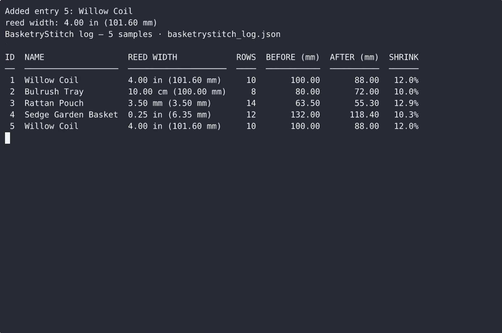
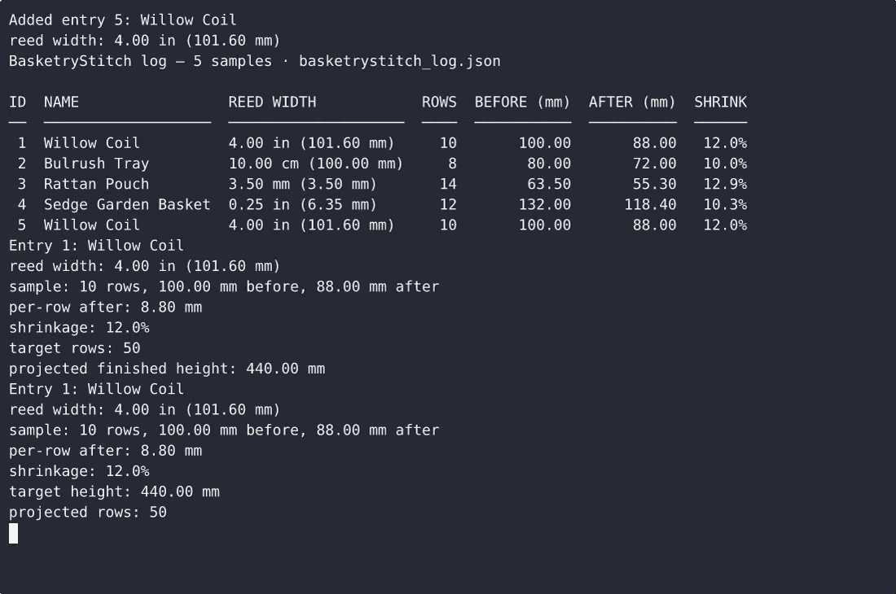

# BasketryStitch — complete Full-stack app command-line tool example app

**BasketryStitch** is a production-grade command-line tool written in Full-stack app — generated by cenius.ai, Apache-2.0-licensed. A single-file, standard-library Python CLI that keeps a coil-and-stitch pattern log on disk: you add a pattern with its reed width (mm or inches), row and stitch counts, list and delete entries, and ask for a row-shri…. Clone BasketryStitch, run the installer, done — you have a working product in minutes. Want to change something? [Open BasketryStitch on cenius.ai](https://cenius.ai/marketplace/p/basketrystitch?ref=gh&utm_campaign=basketrystitch-webapp) and say what you need — a revised build ships back, ready to deploy.


[](LICENSE)  [](https://cenius.ai)

[](https://cenius.ai/marketplace/p/basketrystitch?ref=gh&utm_campaign=basketrystitch-webapp)

> **▶ [Open & edit in cenius.ai](https://cenius.ai/marketplace/p/basketrystitch?ref=gh&utm_campaign=basketrystitch-webapp)** — one click to an editable workspace: describe changes in plain English, get an instant preview, one-click deploy and host. Modifications made on the platform come with full rebrand & relicense rights.

_Local clone? See [Quick start](#quick-start) below. cenius.ai is the zero-setup path._

## Demo


📽 **[Demo video on cenius.ai](https://cenius.ai/marketplace/p/basketrystitch?ref=gh&utm_campaign=basketrystitch-webapp)** — the complete run-through · [MP4](.github/media/demo.mp4)

## Screenshots

 

## Features

- Coil-and-stitch pattern log
- Reed width input
- Row shrinkage estimate

## Quick start

```bash
./install.sh   # installs dependencies + seeds demo data
```

See [`INSTALL.md`](INSTALL.md) for full setup and usage instructions.

## Architecture

Full-stack app project, delivered as a complete runnable codebase (17 files). Top-level layout: `demo/`, `tests/`. `install.sh` wires up dependencies and loads seed records; after it runs the app has real data to show. Step-by-step setup guide: [`INSTALL.md`](INSTALL.md).

## Usage guide

Three commands: `add`, `list`, `estimate`. Everything below is copy-pasteable
and every number is real output of the tool.

### 1. Record a finished sample

You have woven a 10-row sample on 4 in reed. Before finishing it measured
100 mm; after finishing (soaked, packed and dried) it measures 88 mm.

```sh
python3 basketrystitch.py add --name "Willow Coil" --reed-width 4 --unit in \
    --sample-rows 10 --row-height-before 100 --row-height-after 88
```

```
Added entry 1: Willow Coil
reed width: 4.00 in (101.60 mm)
```

Notes:

- `--row-height-before` and `--row-height-after` are the **total** height of the
  whole sample in millimetres, not the height of one row. Measure the swatch on
  the table; the tool divides by `--sample-rows` for you.
- `--reed-width` accepts decimals (`0.25`, `3.5`). `--unit` is `in`, `cm` or
  `mm` and defaults to `in`; the width is stored normalised to millimetres so
  samples in different units stay comparable in one list.
- A blank (or whitespace-only) `--name` is refused with exit code 2 and the log
  is left exactly as it was:

  ```sh
  python3 basketrystitch.py add --name "   " --reed-width 4 --sample-rows 10 \
      --row-height-before 100 --row-height-after 88
#  # error: --name must not be blank; give the sample a name     (exit 2)
  ```

### 2. Compare the log

```sh
python3 basketrystitch.py list
```

```
BasketryStitch log — 4 samples · basketrystitch_log.json

_Full guide: [`USAGE.md`](USAGE.md)_

## FAQ

### How do I run BasketryStitch on my own server?

Pull the repo, run `./install.sh`, and you are up — the script installs packages and pre-seeds the database. [`INSTALL.md`](INSTALL.md) covers any platform-specific tweaks.

### How do I make BasketryStitch my own brand?

Yes. You can edit the source directly under the MIT license, or [remix it on cenius.ai](https://cenius.ai/marketplace/p/basketrystitch?ref=gh&utm_campaign=basketrystitch-webapp) — the platform route grants full rebrand and relicense rights over your derivative.

### Is BasketryStitch free for commercial use?

Yes. The code is Apache-2.0-licensed — use it, modify it, and ship it commercially. See [LICENSE](LICENSE).

### What technologies are in BasketryStitch's stack?

Full-stack app. The full source in this repository is exactly what the app runs. Highlights include row shrinkage estimate.

### What if I want to add features to BasketryStitch without coding?

[cenius.ai](https://cenius.ai/marketplace/p/basketrystitch?ref=gh&utm_campaign=basketrystitch-webapp) handles the implementation. Tell it what you want in everyday words, pick up the updated build. No coding needed.

## License & rebranding

Released under the [Apache License 2.0](LICENSE) (© 2026 Cenius AI) — free for personal and commercial use. The Cenius name/logo are trademarks (see NOTICE).

**Need a customized version?** [Remix this app on cenius.ai](https://cenius.ai/marketplace/p/basketrystitch?ref=gh&utm_campaign=basketrystitch-webapp) — modifications made on the platform come with **full rebrand & relicense rights** over your derivative.

## Built with cenius.ai

This entire application — code, design, seeded demo data — was generated on **[cenius.ai](https://cenius.ai)** from a plain-English description.

- 🚀 [Build your own app on cenius.ai](https://cenius.ai)
- 🎛️ [Remix BasketryStitch on the marketplace](https://cenius.ai/marketplace/p/basketrystitch?ref=gh&utm_campaign=basketrystitch-webapp) — open it in a workspace, prompt for changes, and ship your own version.

More open-source apps: [the Cenius-ai catalog](https://github.com/Cenius-ai) · [showcase index](https://github.com/Cenius-ai/showcase)
